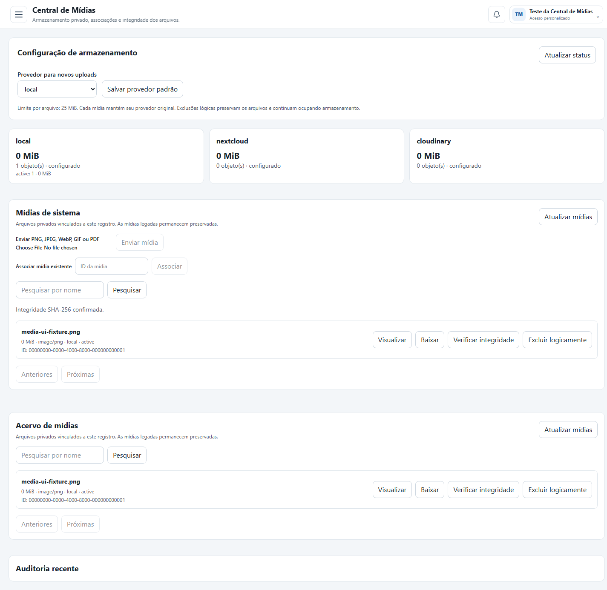

# Entrega — Central de Mídias

Branch: `codex/finalize-media-center`.
Checkout de trabalho: `C:\Users\Administrator\Desktop\helpdesk-media-work`.
Base analisada: [PR #20](https://github.com/MiguelAlmeidaJ/Helpdesk-legado/pull/20), já incorporado à main.

## Implementado

- Pool SQL Server independente, com banco helpdesk_media e credenciais dedicadas. O esquema é explícito, aditivo e reaplicável. O startup não cria tabelas nem migra o acervo.
- Upload com MIME real e limites; associação transacional somente após leitura de confirmação de tamanho e SHA-256. Estados de quarentena para falhas; exclusão somente lógica e auditoria persistente.
- Download privado com controle por módulo, responsável e cliente, sem expor provider_key, URLs assinadas ou credenciais. Mídias compartilhadas exigem autorização em todos os vínculos para alteração.
- Local C:\HelpdeskMedia com chaves UUID, criação exclusiva, leituras limitadas e defesa contra travessia/junctions/symlinks; script de ACL Windows.
- Nextcloud WebDAV autenticado, HTTPS, limite de leitura, timeout, recusa de redirecionamento e condição de não sobrescrita.
- Cloudinary com upload autenticado assinado, identificação imutável do asset, recuperação pela API assinada com expiração e exclusão restrita a objetos criados pelo provedor. O endpoint público da Central só exclui logicamente.
- Tela administrativa em /administracao/midias: configuração do padrão, consumo registrado por estado/provedor, pesquisa, paginação, upload, visualização, associação, verificação e auditoria. Os painéis atualizam o acervo e os indicadores após operações.
- Painéis integrados a sistema, catálogo, atendimento, projeto e tarefa DevOps. Mídias legadas e HTML original preservados.
- Migração por lotes com dry-run padrão, relatório JSONL, referências históricas, SHA-256, deduplicação e reexecução idempotente. Aplicação real depende de --apply e autorização por variável de sessão; nenhum agendamento.

## Preparação realizada neste ambiente

O banco **helpdesk_media** foi preparado na instância local existente, sem DDL ou DML no banco de negócio. O login helpdesk_media_app tem somente a role de execução da Central. A conferência retornou sysadmin=0, CREATE TABLE=0 e CONTROL DATABASE=0. O script SQL foi reaplicado sem erros para conferir idempotência.

As credenciais foram geradas e gravadas apenas no .env ignorado pelo Git do checkout isolado. Nenhuma senha foi exibida, enviada ao frontend ou incluída neste relatório. O .env da instalação original não foi alterado. A pasta C:\HelpdeskMedia recebeu ACL restrita; o teste físico local usou somente um arquivo sintético, removido ao final. A pasta não recebeu arquivos do acervo.

Depois dos testes, a consulta de media_objects retornou **zero objetos persistidos**. Fixtures de metadados e auditoria foram revertidas por rollback. Não foi executada migração real, reinício de PM2, atualização dos dados de navegação da instalação ou merge na main.

## Validação

| Verificação | Resultado |
| --- | --- |
| Build completo do monorepo | Passou: contracts, database, NestJS e Next.js, incluindo a nova página |
| test:media | 11 testes: MIME/tamanho, caminhos, symlink, provedores, assinaturas, limites de leitura remota, escopo próprio, clientes externos e compartilhamento |
| test:media:sql | Teste SQL Server + Nest HTTP passou; inclui rollback, conteúdo privado, MIME falso, falha de provedor, checksum e exclusão lógica |
| test:navigation | 6 testes passaram, incluindo destinos implementados e proteção administrativa |
| test:security | 4 testes passaram |
| Provedor local real | Upload/read/SHA-256/remove de PNG sintético passou |
| Nextcloud e Cloudinary | Testes de protocolo simulados passaram; variáveis de credenciais ausentes neste ambiente |
| Navegador Edge headless | Tela compilada testada com API de fixtures isolada: upload, atualização do acervo, verificação e exclusão lógica; zero exceções JavaScript não tratadas |
| Segredos e alterações | Nenhuma credencial configurada encontrada nos arquivos alterados; git diff --check passou |

A captura e o teste de navegador usam dados sintéticos. As três opções aparecem configuradas nessa fixture para testar a interface; isso não significa que contas reais Nextcloud/Cloudinary tenham sido conectadas. O teste HTTP/SQL separado valida o backend real da implementação. O script de navegador não cria sessões nem acessa mídias reais: intercepta todas as requisições /api.

## Simulação final de migração

Relatório: [JSONL completo](reports/media-migration-a7ca76db-0f7b-45f6-9097-bbd377f9738e.jsonl).

| Classificação | Referências |
| --- | ---: |
| Examinadas | 3.805 |
| Conteúdos únicos elegíveis | 1.195 |
| Cópias de conteúdo já encontrado | 93 |
| Ausentes | 2.167 |
| Referências externas, deduplicadas por catálogo | 307 |
| Destinos externos distintos no conjunto | 237 |
| Conteúdos não aceitos pela validação | 43 |
| Transferências / falhas operacionais | 0 / 0 |

As 2.167 ausências abrangem 2.165 referências em documentos, o catálogo id=2 e uma referência local adicional do HTML de catálogo. São referências de origem, não uma confirmação de arquivos únicos perdidos globalmente. Nenhuma URL externa foi baixada.

Os 43 conteúdos não aceitos são três contêineres MP4, um HTML, um ZIP/Office e 38 imagens Base64 de RD que não passam a validação de completude. Esses dados permanecem intactos para análise. Por isso os elegíveis da migração não equivalem às 1.323 imagens reconhecidas por assinatura no inventário anterior; a migração aplica verificações adicionais e também admite PDFs. A simulação identificou 1.288 referências elegíveis somando conteúdos únicos e cópias, com 205.313.976 bytes de payload. O campo bytes soma referências, sem descontar duplicatas.

## Pendências antes de produção e migração real

1. Revisar esta branch e aprovar a implantação. A aplicação em execução continua utilizando a instalação original.
2. Configurar credenciais reais de Nextcloud/Cloudinary, se forem utilizados, e executar os respectivos roundtrips com --run. Os testes simulados não comprovam configuração, permissões ou políticas da conta real.
3. Implantar a conexão e os segredos no .env/cofre da instalação aprovada, revisar a conta Windows da API e o certificado SQL, atualizar a navegação e os processos pelo procedimento de implantação.
4. Autorizar expressamente a migração real antes de habilitar o comando de aplicação. Recuperar os arquivos ausentes e analisar os 43 conteúdos recusados separadamente. URLs externas precisam de uma política e fonte de recuperação; não há download automático.
5. Proteger e incluir o banco de metadados e os arquivos/provedores no plano de backup. A Central mede o volume registrado, não a cota total remota. Recuperação de quarentena e reconciliação de uploads interrompidos são operações de revisão, sem purge automático.

Não foi criado mecanismo de ativação automática de migração ou remoção de mídias legadas. Não há conversão de formatos/transcodificação de vídeo nesta entrega. A vinculação de Base64 de RD usa o contexto administrativo system/global; não foi adicionado um sexto contexto de despesas nem alterado o módulo financeiro.

Instruções completas e variáveis: [media-storage-architecture.md](media-storage-architecture.md).
