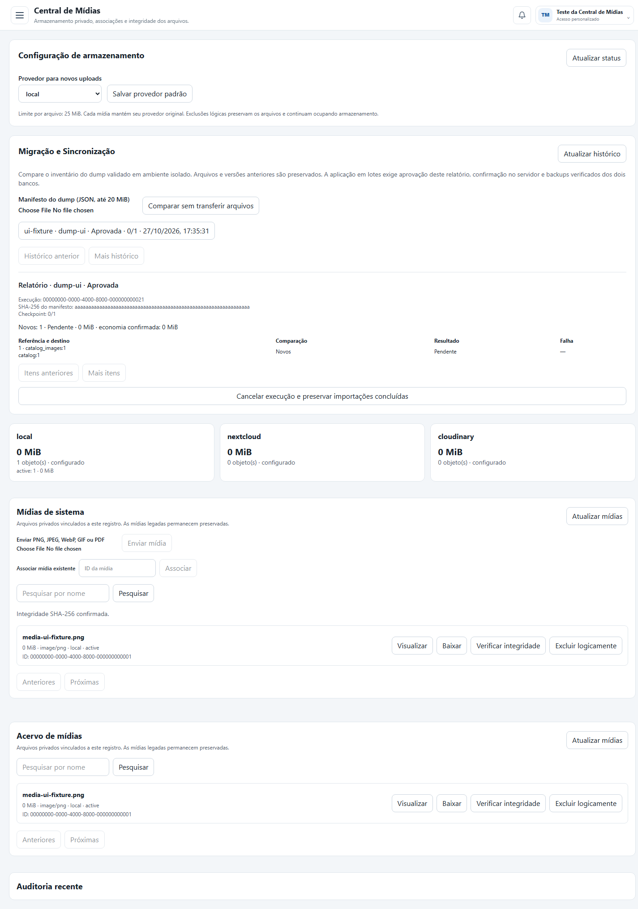

# Entrega — sincronização incremental de mídias

Branch: `codex/media-incremental-sync`. Implementação em worktree separado, sem merge, implantação ou migração real.

## Implementado

- Inventário compartilhado com o migrador legado e comparação persistente por origem/dump, com manifesto normalizado e SHA-256.
- Identidade de entidades independente do ID numérico, incluindo cliente, validação de unicidade e mapa explícito de remapeamento.
- Deduplicação por SHA-256/tamanho em qualquer provedor, com leitura e verificação antes de reutilizar; novas versões preservam objetos e vínculos anteriores.
- Referências ausentes no dump ficam para revisão; exclusões lógicas não são ressuscitadas automaticamente. Adoção opcional e explícita do histórico sem namespace do migrador anterior.
- Checkpoints por item/lote, UUID e recibo de cada lote, savepoints, retomada e detecção de lotes interrompidos. Trava SQL entre processos e IDs de reserva determinísticos evitam duplicar uploads após interrupções.
- Aprovação administrativa pela sessão autenticada, confirmação digitada, confirmação adicional no CLI e revalidação do administrador ativo em cada lote. Não há aplicação automática nem endpoint HTTP de execução.
- Comprovantes HMAC de backups FULL/CHECKSUM dos dois bancos, com verificação de banco, idade da verificação, tamanho, mtime e SHA-256 antes da aprovação e de cada lote.
- Área **Migração e Sincronização** com comparação, histórico, relatórios, aprovação, retomada e cancelamento; relatórios JSON completos por CLI e API paginada.
- Esquema SQL aditivo, variáveis documentadas e procedimento de implantação/produção em [media-incremental-sync.md](media-incremental-sync.md).

## Validação executada

| Verificação | Resultado |
| --- | --- |
| Build completo do monorepo | Aprovado; API e web, 65 rotas |
| `pnpm test:media` | 11 testes aprovados |
| `pnpm test:media:sync` | 6 testes aprovados |
| `pnpm test:media:sync:sql` | Integração SQL Server/Nest HTTP aprovada |
| `pnpm test:navigation` | 6 testes aprovados |
| `pnpm test:security` | 4 testes aprovados |
| Navegador Edge, API simulada isolada | Comparação, confirmação/aprovação, upload, integridade e exclusão lógica; nenhuma exceção JavaScript |
| Esquema de testes aditivo/idempotente | Aplicado repetidamente somente em `helpdesk_media_test_sync` |
| Identidade no SQL Server real | Consulta somente de leitura em um catálogo; identidade validada |
| Banco de mídias real | Consulta de conferência: zero objetos; esquema de sincronização não implantado |
| Varredura de segredos e `git diff --check` | Sem vazamentos ou erros de whitespace |

Total: 28 testes aprovados, além do teste de navegador. A integração SQL usa objetos sintéticos em diretório temporário e exclusivamente `helpdesk_media_test_sync`; não executa DROP/TRUNCATE. Os registros sintéticos desse banco de testes ficam preservados. Exercita duplicatas, repetição idempotente, alterações, versões antigas, remapeamento, bloqueio de ID reutilizado, ausências, conflito entre conexões, falhas parciais, falha após upload, rollback do checkpoint com recibo persistente, retomada, reservas em quarentena, plano desatualizado, adoção do histórico antigo e guardas HTTP 401/403/409.

## Pendente de revisão e autorização operacional

- Revisar o PR, aplicar o esquema aditivo na instalação e configurar chave privada/pasta de comprovantes. A aplicação em execução e a `main` local não foram alteradas por esta entrega.
- Validar o dump definitivo em ambiente isolado e revisar o mapa de IDs. Identidades ambíguas ou campos de identidade alterados exigem revisão; não existe opção de ignorar a conferência.
- Criar e verificar backups reais de negócio e metadados. Os testes usam comprovantes sintéticos e chave efêmera; o comando DBA de `VERIFYONLY` não foi executado contra backups reais nesta entrega.
- Testar Nextcloud/Cloudinary reais quando houver credenciais e autorização. Os testes de protocolo existentes usam respostas simuladas; o armazenamento local foi exercitado com arquivos sintéticos.
- Revisar vínculos antigos sem identidade registrada antes de liberar dumps com IDs remapeados. Reservas incompletas/quarentenadas requerem inspeção operacional; não há reenvio, purga ou recuperação destrutiva automática.
- Autorizar explicitamente a aplicação de um relatório aprovado. Nenhum arquivo legado foi excluído/sobrescrito e nenhuma sincronização do acervo real foi executada.
