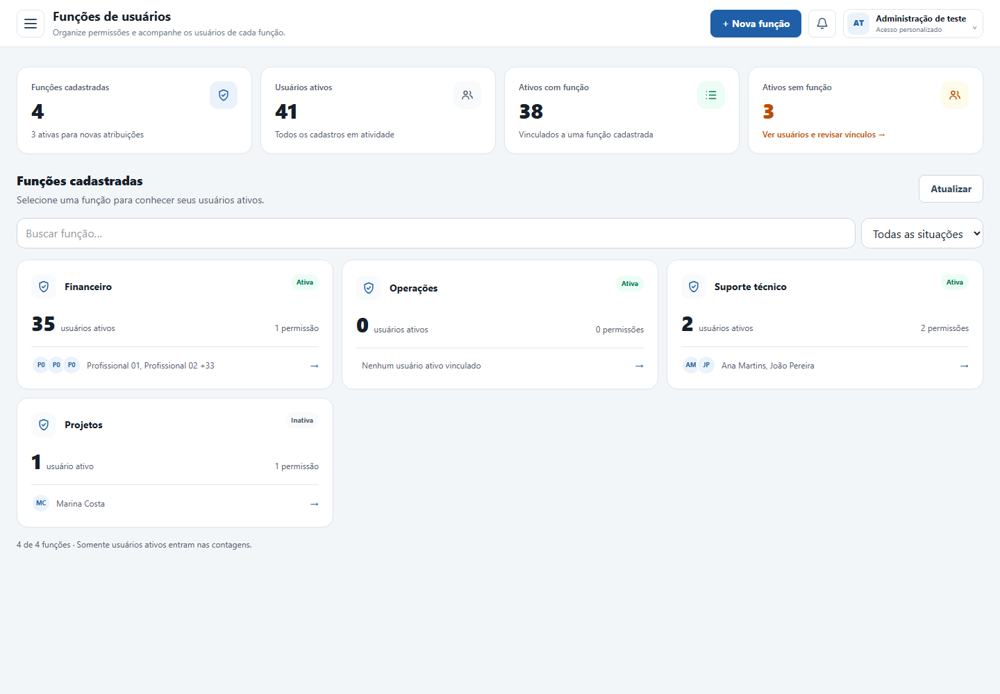
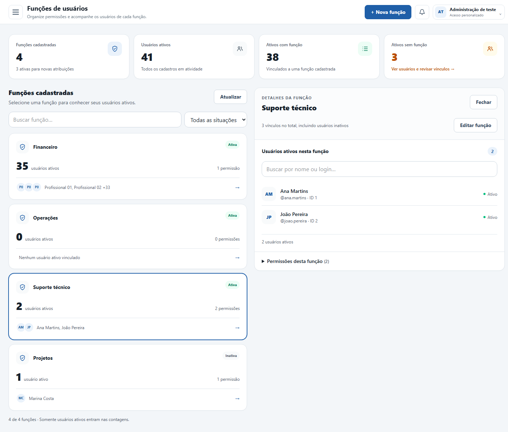
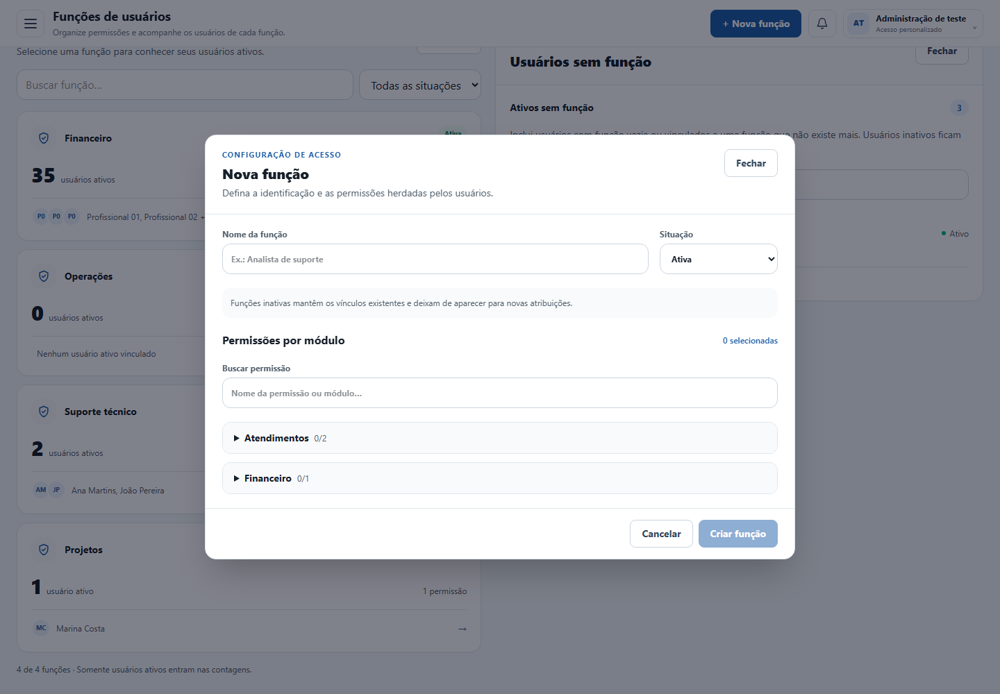

# Funções de usuários — consulta de usuários ativos

A página passa a separar consulta e edição. A entrada mostra funções em cards com situação, quantidade de permissões e prévia dos usuários ativos. Selecionar uma função abre os nomes e logins dos usuários, com busca e paginação de 30 registros. O resumo mostra funções cadastradas, usuários ativos, ativos com função e ativos sem função; o último card abre a lista para revisão.

O formulário não é renderizado na entrada. **Nova função** e **Editar função** abrem uma janela com foco no nome, navegação por teclado, fechamento com Escape e retorno do foco ao botão. As permissões ficam agrupadas em módulos expansíveis. Criar, editar e excluir mantêm o comportamento da API existente; a exclusão continua bloqueada quando há qualquer usuário vinculado, inclusive inativo.

`GET /api/user-functions/active-users` retorna somente ID, nome, login e ID da função para usuários com `user_sts = 1`. A consulta inclui funções inativas ainda cadastradas como vínculos válidos. Funções vazias, zeradas ou inexistentes entram em **sem função**. Os totais derivam da mesma consulta que retorna os usuários. O endpoint exige sessão e `system.admin`, e usa `Cache-Control: private, no-store`.

Validação:

- Build completo do monorepo aprovado.
- `pnpm test:user-functions`: SQL Server com fixtures CTE somente de leitura, cobrindo usuários inativos, função inativa e vínculos nulos, zero ou inexistentes; HTTP 401/403/200 com o guard real de permissões.
- `pnpm test:user-functions:ui`: navegador Edge com API totalmente simulada; formulário fechado na entrada, listas de usuários, busca, paginação, criação/edição/exclusão, foco, Escape e largura mobile. Nenhuma exceção JavaScript.
- Consulta somente de leitura no banco da instalação: 19 funções, 55 usuários ativos, 55 com função e zero sem função. Os totais por função coincidiram com o resumo anterior. Esses números são uma conferência desta entrega; a tela sempre consulta os valores atuais.
- Nenhuma alteração de esquema ou escrita em cadastros reais. Testes de operações de escrita usam exclusivamente a API simulada do navegador.

## Prévia com dados sintéticos

